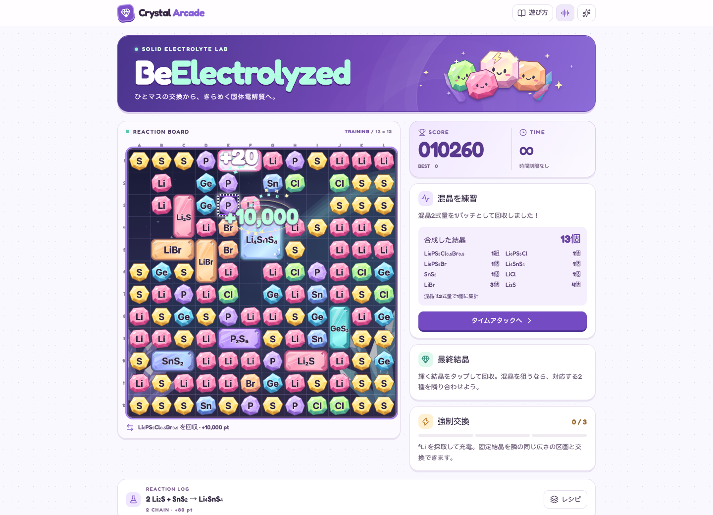
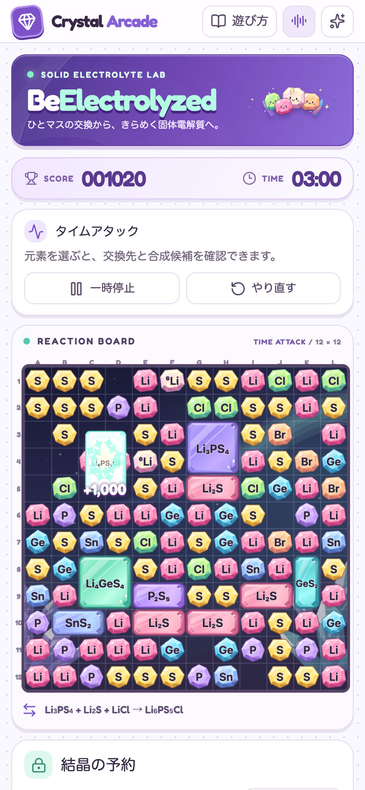
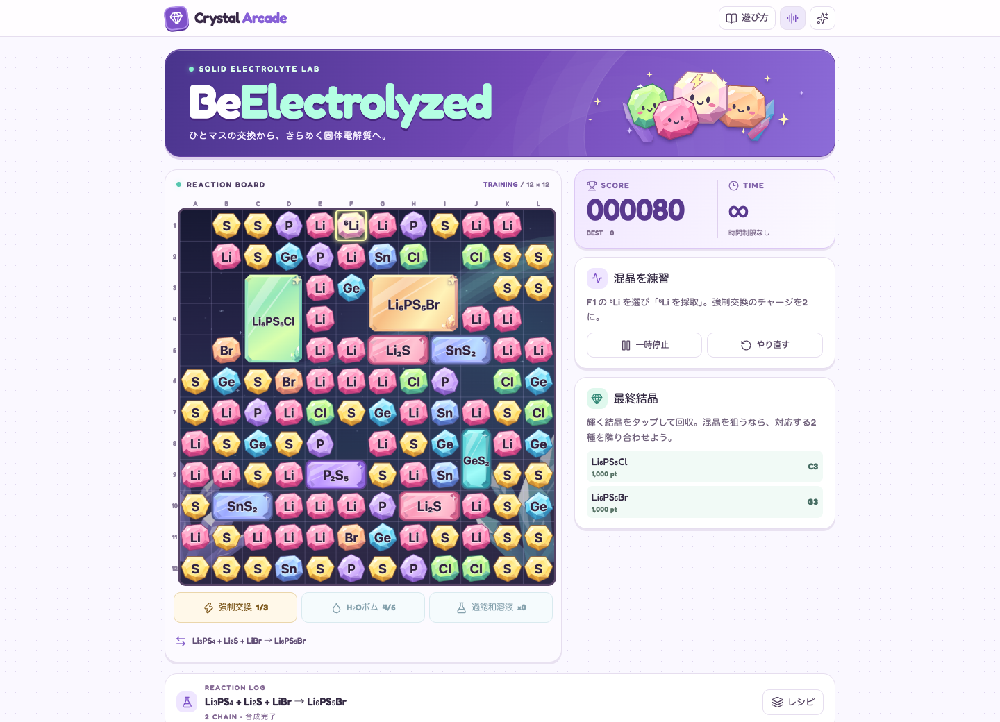

# BeElectrolyzed

**[▶ BeElectrolyzed を遊ぶ](https://ks250206.github.io/BeElectrolyzed/)**

ピンクの Li を左端の空きマスへ。隣の Cl と LiCl になり、その先の材料までつながれば、大きな固体電解質の結晶が育ちます。12×12マス、180秒のタイムアタック。固定された化合物の周りに空間を残しながら、元素を上下左右に交換するパズルです。



## 最初のひと手

- **回収を練習**では A4 の Li を押し、次に A3 を押します。LiCl → Li₆PS₅Cl の2連鎖で完成した結晶が C3 で輝きます。タップして1,000点を回収しましょう。初めての方はここからどうぞ。
- **混晶を練習**では A4 → A3、I4 → I3 と交換。最終結晶が2個そろったら F1 の ⁶Li を採取します。盤面下の「強制交換」を押し、C3 の結晶 → E3 の順に選ぶと、混晶2式量が1バッチとして完成します。盤面でタップすると10,000点です。練習は時間無制限で、ベストスコアの対象はタイムアタックです。
- **盤面の結晶をタップ**すると、その結晶を選んだ状態で通常盤の180秒が始まります。「プレイ開始」ボタンからも始められます。序盤の上段にはハロゲン系の材料、下段には Ge 系または Sn 系の材料があります。I9 の Li₂S を強制交換で G9 に置くルートも試してみてください。
- **完全ランダム**では、元素130個と空き14マスの位置を毎回抽選します。⁶Li 2個の位置もランダムで、Li と S はレシピに合わせて出やすくしています。化合物はすべて自分で合成。制限時間は180秒で、ベストスコアは通常盤と別に保存します。URL に `?seed=24` のように整数を指定すると、同じ初期盤面を再現できます。



## 操作と得点

| やりたいこと | 操作とルール |
| --- | --- |
| 1マス交換 | 元素と隣の元素または空きマスを順にタップ。マウスやタッチで隣へドラッグしても交換できます。合成しない交換も可能です。 |
| キーボード | Tab で盤面へ移動し、矢印でカーソルを動かします。Enter または Space で選択・決定、Esc で選択解除。各ボタンにも Tab で移動できます。 |
| 固定結晶を動かす | 盤面下の「強制交換」を押し、動かす結晶 → 点線の移動先の順に選びます。同じ大きさの区画が丸ごと入れ替わります。境界が別の結晶を切る方向は選べません。通常は1チャージ。最終結晶・混晶は2チャージ。もう一度「強制交換」を押すと無料で取り消せます。 |
| チャージを増やす | ⁶Li を選んで「採取」。直接の得点はなく、1チャージ増えます。通常の Li として合成した場合はチャージを得ません。初期1、最大3。上限では採取できません。 |
| 最終結晶を回収 | 盤面に残った結晶が数秒おきに輝きます。結晶のどのマスでもクリック・タップ、またはカーソルを合わせて Enter で即回収。混晶を狙うときは盤面に残し、対応する2種を辺で接触させます。時間切れには残った分をすべて自動回収します。 |
| スコア | 二元化合物は合成で20点、中間体は80点。最終結晶は回収時にハロゲン系1,000点、Ge/Sn系1,800点。混晶も回収時に、材料2個分の基礎点と混晶ボーナスを合わせて10,000点または15,600点が入ります。 |
| 一時停止・設定 | 一時停止かレシピ集で時計を止めます。タブを隠したときも一時停止。音と演出軽減はヘッダーで切り替えられ、ベストスコアとともにブラウザに保存します。 |



## 盤面アイテムとリザルト

盤面下には「強制交換」「H₂Oボム」「過飽和溶液」が横一列に並びます。H₂Oボムと過飽和溶液は通常盤・完全ランダムで使えます。

- **H₂Oボム**　連鎖中も含め、二元化合物を6個合成すると水滴が1滴たまります。満タンの間は1滴を保持します。ボタンを押して盤面を選ぶと3×3の対象が青く光り、同じマスをもう一度押すと溶けて新しい元素結晶に変わります。盤端では範囲が内側に寄ります。最終結晶・混晶、範囲をまたぐ結晶、元の空きマスは保護されます。
- **過飽和溶液**　開始時に1瓶。ボタンを押すと空きマスがすべて光ります。「○マスを埋める」で確定すると、溶液から元素結晶が一斉に晶出して盤面が満杯になります。どちらのアイテムも確認中はキャンセルでき、晶出直後の元素は次の操作から合成に使えます。

終了画面の中央には、自動回収分を含む**最終スコア**が大きく表示されます。その下に、回収数、混晶の組数、合成した結晶の総数と化学式別の個数が並びます。連鎖で次の材料に使った結晶も数えます。Li₃PS₄ の2個生成は2個、混晶の2式量は1バッチで1個です。初期配置、補充、アイテムによる晶出、完成した結晶の回収は合成数に加えません。

## 盤面を読む

白枠は選択中、点線は交換できる場所です。盤面下には候補手の座標と合成式が表示され、最初の生成位置にミント色の網掛けが出ます。赤枠が出たら、表示されたサイズの置き場を材料の周囲に作ってください。

1. 動かした結晶を起点に、辺でつながる**必要な種類・個数の結晶**を探します。大きい結晶も1個です。空きができた交換や採取・回収では、その空間に接する結晶も調べます。
2. 混晶 → 最終結晶 → 中間体 → 二元化合物の順に、材料跡と空きマスに生成物が収まる組み合わせを探します。各生成物は材料跡と重なる必要があります。複数出力は全部置ける場合にまとめて合成。高優先の反応が空間不足になった材料は、その手の低優先反応から保護します。
3. 新しい生成物が次の反応につながれば連鎖。固定結晶も元素も重力で落下しません。最後に乱数シードに従って元素を補充します。補充しただけでは反応しません。
4. 通常の補充目標は144マス中130マス。⁶Li は初期盤面に2個あり、通常交換6手ごとに補給機会が1回生まれます。盤上2個まで、補給のため最大132マスまで使用します。置けないときは次の補充に1回分を繰り越します。採取では⁶Liを補給しません。

### 元素から最終結晶を作って回収する

[seed 1 の盤面](https://ks250206.github.io/BeElectrolyzed/?seed=1)で「完全ランダム」を選び、I7 → J7、H8 → G8、I10 → H10 と3回交換します。元素から Li₆PS₅Br ができ、この時点では二元化合物と中間体の合成分で200点です。光っている Li₆PS₅Br を押すと1,000点を回収できます。

## 合成レシピ

| 階層と盤面サイズ | 反応 |
| --- | --- |
| 二元化合物 · 2×1 / 1×2 | 2 Li + S → Li₂S<br>Ge + 2 S → GeS₂<br>Sn + 2 S → SnS₂<br>2 P + 5 S → P₂S₅<br>Li + Cl → LiCl<br>Li + Br → LiBr |
| 中間体 · 2×2 | 3 Li₂S + P₂S₅ → **2 Li₃PS₄**（独立した2ブロック）<br>2 Li₂S + GeS₂ → Li₄GeS₄<br>2 Li₂S + SnS₂ → Li₄SnS₄ |
| 最終結晶 · 2×3 / 3×2 | Li₄GeS₄ + 2 Li₃PS₄ → Li₁₀GeP₂S₁₂<br>Li₄SnS₄ + 2 Li₃PS₄ → Li₁₀SnP₂S₁₂<br>Li₃PS₄ + Li₂S + LiCl → Li₆PS₅Cl<br>Li₃PS₄ + Li₂S + LiBr → Li₆PS₅Br |
| 混晶バッチ · 3×3 / 4×2 / 2×4 | Li₆PS₅Cl + Li₆PS₅Br → **2 Li₆PS₅Cl₀.₅Br₀.₅**<br>Li₁₀GeP₂S₁₂ + Li₁₀SnP₂S₁₂ → **2 Li₁₀Ge₀.₅Sn₀.₅P₂S₁₂** |

P₂S₅ は、一般に分子式 P₄S₁₀ で表される硫化リンの組成式です。⁶Li は原子数の計算で Li として扱います。盤面の式は元素収支を保存するゲームモデルです。混晶の矢印は端成分から平均組成を作る表現で、実験の反応経路・速度・合成条件はモデルの対象外です。得点にはゲーム内での組み立ての難しさを反映しました。

- Li₄GeS₄ と Li₃PS₄ を使う LGPS の合成、および Li₄SnS₄ を使う Sn 系の前駆体ルート。[Tanigaki et al., Chem. Commun. (2025)](https://doi.org/10.1039/D4CC04708G) · [Bron et al., JACS (2013)](https://doi.org/10.1021/ja407393y)
- 混合ハロゲン組成 Li₆PS₅Cl₀.₅Br₀.₅ の報告、および Ge/Sn 固溶体の組成範囲。[J. Power Sources (2019)](https://doi.org/10.1016/j.jpowsour.2018.11.029) · [Kato et al., J. Power Sources (2014)](https://doi.org/10.1016/j.jpowsour.2014.07.159)

## 開発と公開

Node.js **26.13.0**、pnpm **12.21.0**。React 19・TypeScript 7・Tailwind CSS 4・PixiJS 8 の CanvasRenderer を使用しています。結晶イラスト、洞窟背景、Web Audio 音源は同じ作者の [LGPS-drop](https://github.com/ks250206/LGPS-drop) の MIT ライセンス実装を基にアレンジしました。

```sh
pnpm install --frozen-lockfile
pnpm dev
pnpm typecheck
pnpm test
pnpm build
pnpm preview
```

表示されたローカルURLの `/BeElectrolyzed/` を開きます。[ゲームエンジン](src/game) は描画と独立しています。[テスト](tests) は15反応の原子収支、置き場不足と代替候補、剛体交換、同位体、手動・時間切れ回収の精算、タイムアウト、通常盤の20手などを検証します。

画像は本番ビルドを Chromium でプレイして撮影したものです。キーボード、タッチドラッグ、通常回収、予約操作なしの混晶化・混晶回収、レシピ集、一時停止、時間切れと再スタートを確認しました。スマートフォンは390×844のタッチエミュレーションです。main への push で固定lockfileからインストールし、型チェック・テスト・ビルドの成功後に GitHub Pages へ公開します。[デプロイ履歴](https://github.com/ks250206/BeElectrolyzed/actions/workflows/pages.yml)
